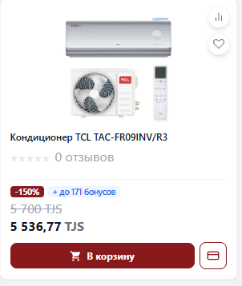

# Manual Testing

Мои практические баг-репорты.

# Bug Reports: Форма регистрации

**Project:** Регистрация пользователя  
**Type:** Manual Testing  
**Author:** Ulugbek Zinatov

---

## BUG-001: Система позволяет зарегистрироваться без Email

**Environment:**
- OS: Windows 11
- Browser: Google Chrome
- Test Type: Manual Testing

**Preconditions:**
- Открыта страница регистрации.
- Пользователь не зарегистрирован.

**Steps to Reproduce:**
1. Открыть страницу регистрации.
2. Заполнить все обязательные поля, кроме Email.
3. Нажать кнопку Register.

**Expected Result:**
Система должна запретить регистрацию и показать сообщение о том, что поле Email обязательно.

**Actual Result:**
Система успешно регистрирует пользователя без Email.

**Severity:** Medium

**Priority:** High

---

## BUG-002: Система принимает Email без символа @

**Environment:**
- OS: Windows 11
- Browser: Google Chrome
- Test Type: Manual Testing

**Preconditions:**
- Открыта страница регистрации.

**Steps to Reproduce:**
1. Открыть страницу регистрации.
2. Заполнить обязательные поля.
3. Ввести в поле Email значение `muslim.gmail.com`.
4. Нажать кнопку Register.

**Expected Result:**
Система должна отклонить некорректный Email и показать сообщение об ошибке.

**Actual Result:**
Система принимает некорректный Email и завершает регистрацию успешно.

**Severity:** Medium

**Priority:** Medium

---

## BUG-003: Пароль отображается открытым текстом

**Environment:**
- OS: Windows 11
- Browser: Google Chrome
- Test Type: Manual Testing

**Preconditions:**
- Открыта страница регистрации.

**Steps to Reproduce:**
1. Открыть страницу регистрации.
2. Перейти к полю Password.
3. Ввести пароль `Test12345`.

**Expected Result:**
Пароль должен отображаться скрытыми символами, например точками или звёздочками.

**Actual Result:**
Пароль отображается обычным открытым текстом.

**Severity:** Medium

**Priority:** Medium

---

# Bug Reports: Регистрация на VOLNA.TJ

**Project:** Сайт volna.tj  
**Type:** Manual Testing  
**Author:** Ulugbek Zinatov

---

## BUG-004: Ошибка при регистрации на сайте volna.tj

**Environment:**
- OS: Windows 11
- Browser: Google Chrome 157
- Test Type: Manual Testing

**Preconditions:**
- Открыта главная страница сайта https://volna.tj/.

**Steps to Reproduce:**
1. На главной странице нажать кнопку «Регистрация».
2. Ввести в поле «Имя»: Муслим.
3. Ввести в поле «Фамилия»: Алиев.
4. Ввести в поле «Логин»: Aliev1900.
5. Ввести в поле «Почта»: nttmmv4b@mail.ru.
6. Ввести проверочный код.
7. Нажать кнопку «Зарегистрироваться».

**Expected Result:**
Открывается страница личного кабинета с сообщением об успешной регистрации.

**Actual Result:**
Открывается страница с ошибкой: `DB query error. Please try later.`

**Severity:** High

**Priority:** High

---

# Bug Reports: Скидки на AVRANG.TJ

**Project:** Сайт avrang.tj  
**Type:** Manual Testing  
**Author:** Ulugbek Zinatov

---

## BUG-005: Некорректное отображение скидки на карточке товара

**Environment:**
- OS: Windows 11
- Browser: Google Chrome 157
- Test Type: Manual Testing

**Preconditions:**
- Открыта главная страница сайта https://avrang.tj/.

**Steps to Reproduce:**
1. На главной странице выбрать «Каталог».
2. Зайти в раздел «Техника для дома» → «Кондиционеры».
3. Найти кондиционер TCL TAC-FR09INV/R3.
4. Посмотреть на карточку товара.

**Expected Result:**
Процент скидки соответствует разнице между старой и новой ценой и не превышает 100%.

**Actual Result:**
На карточке отображается скидка «-150%». Старая цена 5 700 TJS, текущая цена 5 536,77 TJS, то есть реальная скидка около 3%.

**Screenshot:**

**Severity:** Medium

**Priority:** High

---

# Bug Reports: HR-портал hr.fnfglobalinc.com

**Project:** Сайт hr.fnfglobalinc.com  
**Type:** Manual Testing  
**Author:** Ulugbek Zinatov

---

## BUG-006: В заявке кандидата поле «Имя» принимает цифры

**Environment:**
- OS: Windows 11
- Browser: Google Chrome 157
- Test Type: Manual Testing

**Preconditions:**
- Открыта страница сайта https://hr.fnfglobalinc.com/apply.

**Steps to Reproduce:**
1. Нажать на кнопку «Заполнить анкету кандидата».
2. В поле «Имя» ввести цифры, например `111111`.
3. Заполнить остальные поля.
4. Нажать кнопку «Далее».

**Expected Result:**
При вводе цифр в поле «Имя» должна появиться ошибка.

**Actual Result:**
Поле «Имя» принимает цифры.

**Severity:** High

**Priority:** Medium

---

## BUG-007: Письмо для восстановления пароля отправляется на несуществующую почту

**Environment:**
- OS: Windows 11
- Browser: Google Chrome 157
- Test Type: Manual Testing

**Preconditions:**
- Открыта страница сайта https://hr.fnfglobalinc.com/apply.

**Steps to Reproduce:**
1. Нажать на кнопку «Забыли пароль».
2. В поле «Email» ввести почту `z5rxihd4@mail.ru`.
3. Нажать кнопку «Отправить».

**Expected Result:**
Должна появиться ошибка с текстом «Такого аккаунта не существует».

**Actual Result:**
Появляется окно с текстом «Запрос принят».

**Severity:** Medium

**Priority:** Medium

---

## BUG-008: В личном кабинете поле «Телефон» принимает и сохраняет буквы

**Environment:**
- OS: Windows 11
- Browser: Google Chrome 157
- Test Type: Manual Testing

**Preconditions:**
- Открыта страница сайта https://hr.fnfglobalinc.com/apply.

**Steps to Reproduce:**
1. Перейти во вкладку «Мой профиль».
2. Нажать на кнопку «Изменить данные».
3. Ввести в поле «Телефон» буквы.
4. Нажать кнопку «Сохранить».

**Expected Result:**
Появляется ошибка с текстом «Некорректные данные».

**Actual Result:**
Поле «Телефон» принимает буквы, и данные сохраняются.

**Severity:** Low

**Priority:** Low

---

## BUG-009: В заявке на подбор персонала можно выбрать желаемую дату в прошлом

**Environment:**
- OS: Windows 11
- Browser: Google Chrome 157
- Test Type: Manual Testing

**Preconditions:**
- Открыта страница сайта https://hr.fnfglobalinc.com/apply.

**Steps to Reproduce:**
1. Нажать на кнопку «Подбор персонала» в левой колонке.
2. Нажать на кнопку «Заявка на подбор».
3. Выбрать дату в прошлом, например 1 ноября.
4. Нажать кнопку «Отправить HR».

**Expected Result:**
В списке выбора дат доступны только даты, начиная с сегодняшнего дня.

**Actual Result:**
Принимаются даты предыдущих дней и месяцев.

**Severity:** Medium

**Priority:** Low
