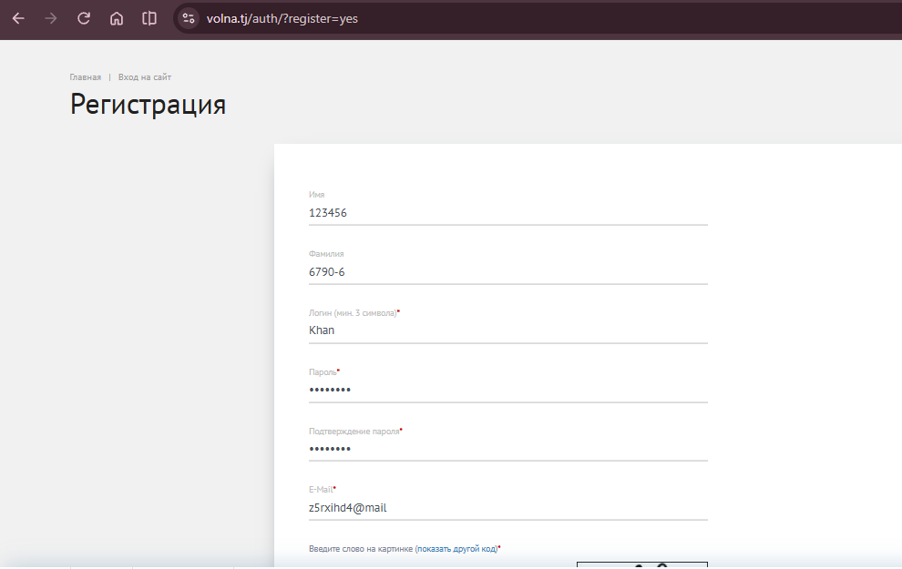
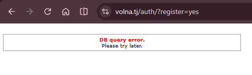
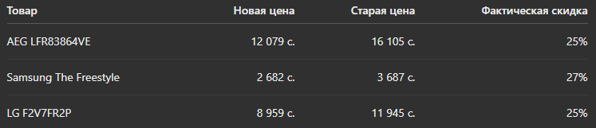

# Баг-репорты: сайт volna.tj

**Проект:** Сайт volna.tj  
**Тип тестирования:** Ручное тестирование (Manual Testing)  
**Автор:** Ulugbek Zinatov

---

## BUG-001: Поля «Имя» и «Фамилия» принимают цифры и специальные символы при регистрации

**Окружение:**
- Windows 11, Google Chrome 157

**Предусловие:**  
Открыта страница регистрации нового пользователя на сайте Volna.tj.

**Шаги воспроизведения:**

1. Открыть форму регистрации
2. Перейти в поле «Имя».
3. Ввести значение 123456
4. Перейти в поле «Фамилия».
5. Ввести значение 6790-6
6. Проверить реакцию системы на введённые данные.

**Ожидаемый результат:**  
Поля «Имя» и «Фамилия» должны проверять введённые данные. Цифры и недопустимые специальные символы не должны приниматься. При вводе некорректных данных система должна отображать сообщение об ошибке.

**Фактический результат:**  
Поля «Имя» и «Фамилия» принимают цифры и специальные символы. Некорректные значения отображаются в полях без предупреждения об ошибке.

**Скриншот:**

**Severity:** High

**Priority:** Medium

---

## BUG-002: Ошибка DB query error при попытке зарегистрировать нового пользователя на сайте volna.tj

**Окружение:**
- Windows 11
- Web: Chrome 157

**Предусловие:**  
Открыта главная страница сайта https://volna.tj/ Пользователь не зарегистрирован.

**Шаги воспроизведения:**

1. Открыть главную страницу сайта
2. Нажать кнопку «Регистрация»
3. Ввести имя: Муслим
4. Ввести фамилию: Алиев
5. Ввести логин: Aliev1900
6. Ввести корректный email
7. Ввести проверочный код
8. Нажать кнопку «Зарегистрироваться»

**Ожидаемый результат:**  
Система успешно регистрирует нового пользователя и перенаправляет его в личный кабинет либо отображает сообщение об успешной регистрации.

**Фактический результат:**  
Вместо успешной регистрации открывается новая страница с сообщением: `DB query error. Please try later.`

**Скриншот:**

**Severity:** High

**Priority:** High

---

## BUG-003: Некорректный процент скидки в карточках товаров

**Окружение:**
- OS: Windows 11
- Browser: Google Chrome 157

**Предусловие:**  
Открыта главная страница сайта Volna.tj. Блок «Популярные товары» отображается.

**Шаги воспроизведения:**

1. Прокрутить страницу до блока «Популярные товары»
2. Выбрать карточку любого товара со скидкой
3. Сравнить процент скидки в бейдже с разницей между старой и новой ценой
4. Повторить проверку для остальных карточек в блоке

**Ожидаемый результат:**  
Процент скидки на каждой карточке товара должен соответствовать разнице между старой и новой ценой. Значение должно рассчитываться корректно и отображаться индивидуально для каждого товара.

**Фактический результат:**  
На карточках товаров отображается одинаковый бейдж «скидка 19%», но фактическая разница между старой и новой ценой соответствует другим значениям

**Скриншот:**

**Severity:** Medium

**Priority:** High

---
